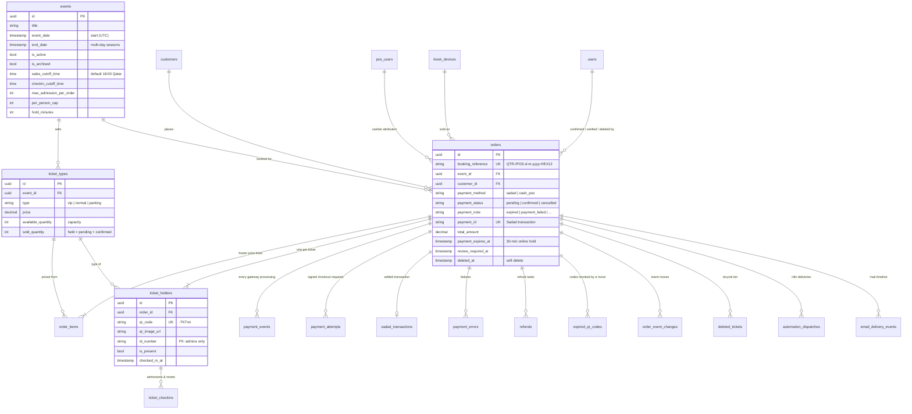
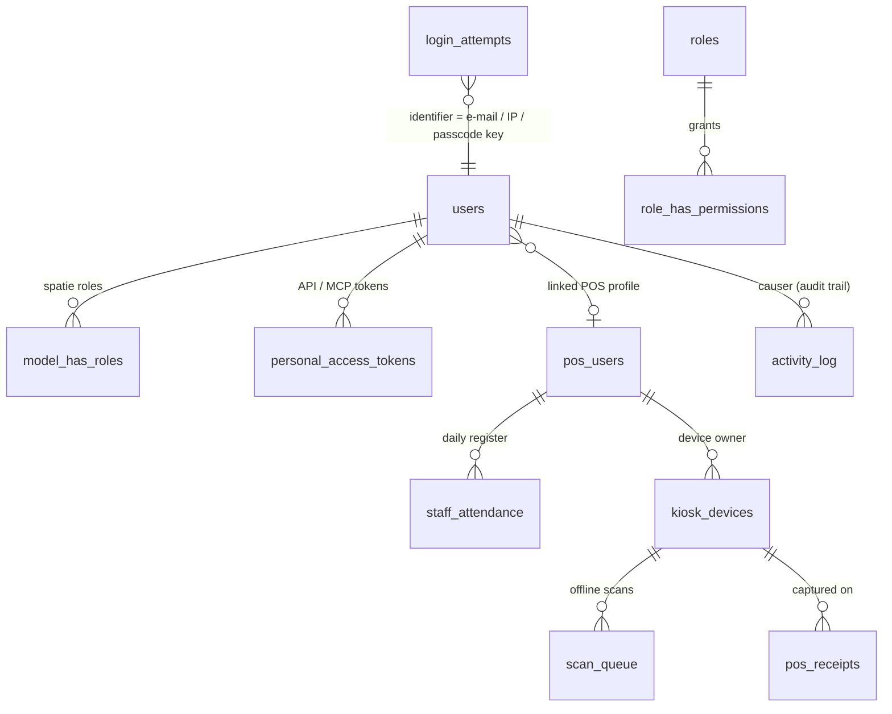

# Data model (ERD)

All business tables use UUID primary keys. Money is `decimal(10,2)` QAR; timestamps are stored in UTC and every
business rule converts to **Asia/Qatar** through `App\Support\QatarClock`.

## Core booking flow

## Staff, access and operations

## Analytics and settings

| Table | Purpose |
|---|---|
| `active_visitors` | One row per live public-site session (heartbeat 60 s, 3-min cutoff, IPs stored masked). |
| `page_views` | Page views with `viewed_on_qatar` for Qatar-day grouping (T-125). |
| `settings` | spatie/laravel-settings groups: branding, contact, sadad (secrets **encrypted**), automation (webhook URLs encrypted), business, events, feature flags, analytics. |
| `activity_log` | Append-only audit (spatie/activitylog + actor type/identifier/IP/UA). Purge by age is owner-only and itself logged. |
| `site_assets`, `popup_banners` | Uploaded brand imagery and homepage pop-ups. |

Constraints worth knowing: `ticket_types.sold_quantity ≤ available_quantity` is enforced by the stock ledger under
`lockForUpdate`; `orders.payment_id` and `ticket_holders.qr_code` are unique; CHECK constraints pin the enum columns.
